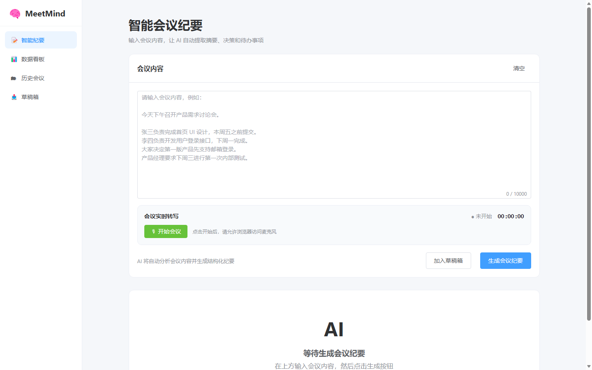

# MeetMind 前端重构 · 三个设计方向

> 状态：**已选定方案 A 并落地**（见文末「落地记录」）。
> 可视图：`shots/a-record-sheet.png` / `shots/b-live-desk.png` / `shots/c-ledger.png`（1440×900）



## 一、先说现状的问题

现在的界面是 Element Plus 默认语言 + 蓝色 SaaS 皮肤，三个具体的毛病：

1. **没有一个界面能让人记住这是 MeetMind。** 蓝色主色、圆角卡片、`el-card` 阴影、emoji 图标，换成任何一家会议工具都成立。
2. **信息被卡片切碎。** 纪要结果被拆成"摘要/决策/待办"三张同构卡片，待办表格挤在卡片里；首页四个入口是同尺寸卡片；看板五个 KPI 是五张一模一样的卡。层级靠容器堆叠，不靠排版。
3. **产品和交付物脱节。** MeetMind 真正交付的是一份**会议记录**，但界面上看不到"记录"的气质：没有文号、没有时间码的位置、没有归档的动作感。

三个方向分别回答"产品的哪一半是主角"：**A 是那份纪要，B 是这场会，C 是这堆会。**

---

## 二、方案 A ·「稿纸」

**一句话**：把界面做成一张可以盖章的会议记录——纸、栏线、时间码、朱印。

**色板**

| 令牌 | 值 | 用途 |
| --- | --- | --- |
| `--paper` | `#FBFBF7` | 纸面（微冷白，不是奶油色） |
| `--desk` | `#EAEAE2` | 桌面（纸外的底） |
| `--ink` | `#191C1B` | 主墨：标题、正文、主按钮 |
| `--ink2` | `#5A625E` | 次墨：说明、表头 |
| `--rule` | `#D6D8D0` | 栏线（唯一的分隔手段） |
| `--vermilion` | `#B5342A` | 印泥朱：只用于状态与归档，不做装饰 |
| `--verm-wash` | `#F5E9E6` | 朱色淡底（印、逾期提示） |

**字体**

- 标题 / 文号：`SimSun`（宋体），用于纪要标题、章节号、印章，字距 +0.04em
- 正文：`FangSong`（仿宋）15.5px / 1.9——公文正文本来的字面，长段落读起来像文件
- 界面：`Microsoft YaHei`（微软雅黑）12.5–13.5px，只出现在按钮、表格、元信息
- 时间码：`Consolas` 等宽，**仅用于时间**（原文页边、时长），不做小标签

全部是 Windows 系统字体，**不下载字体文件、不加依赖**；非 Windows 回退到 Noto Serif CJK / Songti SC。

**布局**

```
┌──────────────────────────────────────────────────────────┐
│ MeetMind │ 会议登记簿 2025年10月        草稿3 收件箱2 ●陈 │ 56
├──────────┬───────────────────────────────────────────────┤
│ 最近登记  │   ┌───────────────────────────────────────┐   │
│ 004 10-01│   │ 时间 10-01 10:13│参会 6│主持 王敏│文号…│   │ 页眉五栏
│ ▸产品评审 │   │         MeetMind 产品需求评审会    [已归档]│  │ 朱印
│ 003 09-28│   │ ──────────────────────────────── 红头线    │
│ 002 09-26│   │ 本次会议确认第一版范围……        （仿宋）   │
│ 001 09-22│   │ 一  核心决策                        3 条   │
│          │   │ 二  待办事项           7 项已完成·共 9 项  │ 栏线表格
│          │   │ 三  会议原文            14分32秒·可回听   │ 页边时间码
│ 页脚说明  │   │ 纪要生成于10:58     回听 导出 [标记完成] │
│          │   └───────────────────────────────────────┘   │
└──────────┴───────────────────────────────────────────────┘
```

左栏不是导航，是**登记簿**：文号、日期、状态点、会议名。点"更多"才进完整台账。

**原则**

- 一屏一纸。纸之外的东西（导航、筛选、设置）都退到纸外，不往纸上加按钮。
- 层级只靠三件事：字号、栏线、缩进。不用阴影、不用卡片、不用色块。
- 红只出现在"结论"和"状态"上——印、逾期、待办未完成。出现第三处就是错。

**动效**（全站只有两个）

- 纪要生成完成时，红头线从左到右画出一次（400ms），印随后落下（轻微旋转回正）。其余元素不动。
- 频道切换只做 120ms 的底色过渡。`prefers-reduced-motion` 下全部取消。

**同一语言覆盖其它页面**

- 历史会议 → 登记簿整页（每行：文号 / 会议 / 状态 / 待办完成度）
- 数据看板 → 统计页：大数字用宋体，四栏之间用竖栏线，不画卡片
- 录制页 → 纸的左侧折出一栏"实时转写"，时间码对齐正文页边
- 空状态 → 一张空白稿纸 + 一行"还没记录，开始一场会"

**代价**：宋体/仿宋在低分屏（1366×768）偏细，需要把正文字号提到 16px 并加 0.5px 字重补偿；密集表格不是它的强项。

---

## 三、方案 B ·「现场台」

**一句话**：开会时界面越暗越好，光只留给会动的东西——计时、波形、刚落下的那一句。

**色板**

| 令牌 | 值 | 用途 |
| --- | --- | --- |
| `--desk` | `#0F1512` | 台面（墨绿黑，不是纯黑） |
| `--panel` | `#141B17` | 右栏面板 |
| `--line` | `#262F2A` | 分隔线 |
| `--txt` | `#E8E6DE` | 正文（暖白） |
| `--brass` | `#D8A24A` | 铜金：唯一信号色，给"正在发生"和主按钮 |
| `--rec` | `#E2544A` | 录制红，只给 REC |
| 浅色态 | `#F3F2ED` / `#1B1E1C` / 同铜金 | 管理页（历史、看板、用户） |

**字体**：界面 `Microsoft YaHei` / `DengXian`，转写正文 14.5px / 1.72；计时与时间码 `Consolas` 27px tabular；不引入展示字体。

**布局**

```
┌────────────────────────────────────────────────────────┐
│ MeetMind  ●录制中 │ 产品需求评审会   本地转写 草稿3 ●陈  │ 52
├────┬───────────────────────────┬───────────────────────┤
│ ▤  │ 实时转写   已记录14:32 12段│ AI 现场提取  ●第12段后 │
│ ▥  │ 00:03:12 王敏              │ 摘要  ……               │
│ ⊙  │   首页这块就按竖导航来……    │ 决策  2                │
│ ▣3 │ 00:05:12 王五              │ 待办  3（可勾）         │
│ ✉2 │   设计稿周五能给……          │ 风险  1                │
│    │ 00:07:28 王敏  （虚线未定） │ 自动分章 3             │
│    │   第一版把「录音…」▍        │                        │
│    │ · 等下一句                 │ 开始 10:13 参会 6 音频 │
├────┴───────────────────────────┴───────────────────────┤
│ ● │ 00:14:32 录音与转写同步 ‖‖‖‖‖  [暂停] [结束并生成] │ 80
└────────────────────────────────────────────────────────┘
```

**双态**：录制与工作台是暗的，管理页（历史/看板/用户/审计）是亮的，靠同一枚铜金连起来。这是它最容易被记住的地方，也是最大的工程代价。

**原则**

- 暗不是风格，是把注意力压到"正在进行"这一件事上。所以只有 REC、波形、新落下的条目允许发光。
- 双栏是等价的：左边是事实（说了什么），右边是结论（AI 提炼了什么）。不许把右栏做成悬浮插件。
- 底部走带条是固定的，任何页面状态下都能一眼看到时长与停止按钮。

**动效**

- REC 红点 1.4s 呼吸；波形跟随音量（没有输入就只是低频抖动）。
- 新一句转写从下方 6px 淡入，AI 提取的条目比它晚 120ms 出现——让人看到"先听到，再提炼"。
- 停止录音到纪要出现的 2 秒，走带条收成一个进度线，不做整页 loading。

**同一语言覆盖其它页面**：历史/看板/用户页走浅色态，用同一套线宽与铜金；纪要详情页给"纸面模式"开关，把深色反成浅色阅读。

**代价**：深色 + 长时间读纪要会累，必须配"纸面模式"；Element Plus 的默认组件在暗底上要逐个改（弹窗、下拉、表格、日期选择器），工作量最大。

---

## 四、方案 C ·「台账」

**一句话**：会后真正的价值是能被检索、被追责、被统计的记录，所以主角是台账——固定栏目、结论进表、数字右对齐。

**色板**

| 令牌 | 值 | 用途 |
| --- | --- | --- |
| `--bg` | `#EDF0EC` | 冷灰绿底 |
| `--card` | `#FFFFFF` | 台账纸 |
| `--ink` | `#12241E` | 深松墨 |
| `--ink-2` | `#5C6B65` | 次文 |
| `--green` | `#2E6F5E` | 主色：已完成、主按钮、完成度条 |
| `--ochre` | `#A9761F` | 警示：置顶、进行中、逾期、分组标签 |
| `--line` | `#CCD5CF` | 线（分组带用 3px，行线用 1px） |

**字体**：分栏头与标题用 `SimHei`（黑体）12–13.5px + 字距，正文 `Microsoft YaHei` 12.5px，数字统一 tabular。**不使用等宽体做小标签**。

**布局**

```
┌──────────┬─────────────────────────────────────────────────┐
│ ▪MeetMind│ ⌕搜索会议、待办、负责人   本周 全部状态 [新建会议]│ 66
│          │ 本月会议 12 │ 待办 9 │ 完成率 78% │ 核心决策 31    │ 汇总条
│ 记录 ────│ ┌─────────────────────────────────────────────┐ │
│  智能纪要│ │ 会议台账 共12份            列设置  全部展开  │ │
│  草稿箱3 │ │ 日期│会议      │结论      │归属│参会│状态│…  │ │
│ 查看 ────│ │──────本周 · 9.29—10.5──────────────────────│ │ 分组带
│  会议台账│ │10-02│首页走查  │只留五个入口│产品│ 4 │已完成│ │
│  数据看板│ │10-01│产品评审 ★│仅支持邮箱…│产品│ 6 │已完成│ │
│  收件箱2 │ │──────上周 · 9.22—9.28──────────────────────│ │
│ 管理 ────│ │09-26│组件库选型│暂缓选型   │设计│ 5 │未开始│ │
│  用户管理│ │ 还有 4 份 · 加载更早的会议                  │ │
│  审计日志│ └─────────────────────────────────────────────┘ │
│ ●陈晓 管理员                                                │
└──────────┴─────────────────────────────────────────────────┘
```

关键一手：**把每场会的结论写进台账的列里**。这样台账不只是索引，扫一眼就知道上周到底定了什么。

**原则**

- 一屏看全 20 条。行高 56，栏目固定，数字右对齐——扫描比阅读重要。
- 不用阴影表达层级，用线宽（3px 组 / 1px 行）和底色带。
- 侧栏按"记录 / 查看 / 管理"分组，因为权限和心智本来就是这样分的；导航项不做装饰性图标。

**动效**（克制，只回答操作）

- 展开一行时行高从 56 长到 220，用 180ms 的 grid-template-rows 过渡，内容不做淡入。
- 悬停只改底色，不做位移与阴影。"置顶"改动时琥珀色左标条滑入一次。

**同一语言覆盖其它页面**：纪要详情 = 台账行展开成整页（左正文、右待办）；看板 = 汇总条 + 三张表；用户管理/审计 = 同一张台账的不同列。

**代价**：第一印象偏"后台管理系统"，缺少情感；移动端必须另一套渲染（表格降级为卡片），工作量中等。

---

## 五、横向对比

| | A 稿纸 | B 现场台 | C 台账 |
| --- | --- | --- | --- |
| 第一眼辨识度 | 高（朱印 + 稿纸） | 很高（暗场 + 铜金） | 中（靠结论列取胜） |
| 上手成本 | 低 | 中（暗色 + 双栏） | 低 |
| 与"纪要"这件事的贴合 | 最强 | 强（贴"开会"） | 中（贴"管理"） |
| 需要改的页面 | 5–6 个 | 8–9 个（含暗色组件） | 8–10 个（含表格组件） |
| 移动端 | 直接降级（单列） | 需重做（走带条 + 单栏） | 需另一套（表格转卡片） |
| 主要风险 | 字体在低分屏偏细 | 暗色组件适配量大、长时间阅读 | 偏后台、情感弱 |
| 我认为的工作量 | 小 | 大 | 中 |

## 六、我的建议

**主线选 A，两个借用**：

1. A 做全局语言（导航、纪要、登录、个人中心、空状态）；
2. **录制页借用 B 的专注态**：只有这一页是暗的，只亮 REC 与波形——"唯一会动的界面最安静"，B 的张力用在该用的地方；
3. **历史/看板借用 C 的台账表格**：A 的登记簿适合首页预览，但二十条以上必须用固定栏目的表。

这样三个方向的好处都留下，风险各自留在最小处。若你要的是"一个方案、一套语言、不留混搭"，我优先推 A。

## 七、落地方式（不管你选哪个）

- 颜色、字号、圆角、线宽全部进 `frontend/src/style.css` 的 `:root`，并覆盖 Element Plus 主题变量（`--el-color-primary`、`--el-border-radius-base`、`--el-font-size-base`、`--el-border-color` 等）；页面里不再写十六进制色值。
- 保留现有路由与信息架构；若采用 C 的"会议台账"叫法，只改导航文案与页面标题，不动路由。
- 组件优先重写 `App.vue`（外壳）、`MeetingResult.vue`（纪要正文）、`HomeView.vue`（录制页）、`HistoryView.vue`（台账）、`DashboardView.vue`（统计）、`LoginView.vue`；业务逻辑、API、composables 一行不动。
- 只改 `<style>` 和模板结构，不新增运行时依赖；字体走系统字体栈。
- 验收：`npm run dev` 目视（1440 / 1024 / 390 三档）+ `npm run build`（`vue-tsc` 类型检查）通过。

## 八、需要你定三件事

1. 选哪个方向：A / B / C / 或者我的混合（A 为主 + B 的录制态 + C 的台账）。
2. 导航文案能不能改（"历史会议" → "会议台账"、"数据看板" → "统计"），还是保持现有用词。
3. 深色录制态要不要（要 = 多一份暗色变量与组件覆写，工作量 +30%）。

---

## 九、落地记录（方案 A）

**已实现的范围**

- 设计系统：`frontend/src/style.css` 重写为令牌（纸／墨／朱／字符／尺度）+ Element Plus 主题变量覆盖 + 版面原语（`.page` `.page-head` `.sheet` `.sec-h` `.prose` `.reg-*` `.blank` `.stamp`）。页面里不再出现十六进制色值。
- 外壳：`App.vue` 改为「顶栏（品牌 + 五个入口 + 用户）+ 左侧登记簿（最近生成的六份纪要，带文号／日期／状态点）」；后台录音与代登身份改为顶部细条。
- 已重写的页面：登录、会议室（首页）、智能纪要（临时／正式）、即时纪要（录制 + 纪要结果）、历史会议、数据看板、草稿箱、收件箱、个人中心、用户管理、审计日志、会议详情（含录音条与分享弹窗）。
- 组件：`MeetingResult.vue` 改为「卷首语 + 一 核心决策 + 二 待办事项」，待办用纸面表格；`MeetingAudioPlayer.vue` 改为走带条；`MeetingShareDialog.vue` 用登记簿行。

**这次没有做的事（避免顺手改需求）**

- 导航文案保持原样：「历史会议」「数据看板」不改名为「会议台账」「统计」。
- 录制页保持浅色纸面（没有引入方案 B 的暗色专注态），因为 A 的语言里它已经足够安静。
- 业务逻辑、路由、API、composables 未改动；没有新增依赖；字体走系统字体栈（宋体／仿宋／雅黑／Consolas）。

**验证**

- `npm run build`（`vue-tsc` 类型检查 + Vite 构建）通过。
- 用真实后端（:3000）与开发服务（:5173）跑通登录、生成纪要、历史检索、看板、草稿、收件箱、用户管理、审计日志；1440 / 1024 / 390 三档目视，390 下无横向溢出（`document.scrollWidth === innerWidth`）。
- 键盘可达：登记簿行可 Tab 聚焦、Enter／空格展开；`:focus-visible` 墨色描边；尊重 `prefers-reduced-motion`。

**导航改为竖向（后续调整）**

- 原来的顶部横向导航已移回左侧竖栏，顺序是：品牌 → 五个入口（智能纪要 / 数据看板 / 历史会议 / 草稿箱 / 收件箱）→ 最近登记 → 用户。当前页用左侧 2px 墨线与字重标记，计数用小号等宽数字。
- 登记簿保留在竖栏内、可独立滚动；竖栏本身贴住视口，内容区变宽（1440 下可用宽度 1164）。
- 窄屏（≤1080）竖栏折成顶部横条：品牌在左、五个入口横向滚动（右侧渐隐提示可滚动）、头像在右，登记簿收起；提示条贴在横条下方。
- `--topbar` 令牌随之移除，详情页录音条的 sticky 偏移改为 18px。

**修复：详情页里切换会议不刷新**

- 现象：从「最近登记」进入 `/history/113` 后，再点 `/history/115`，地址变了但页面仍是 113。
- 原因：`/history/:id` 是同一条路由记录，切换 id 时 Vue 复用组件，不会重新走 `onMounted`；原代码只在那里调用 `loadMeeting()`。
- 修法：在 `MeetingDetailView.vue` 里监听 `route.params.id`，变化时清空旧记录、重新拉取、必要时补通讯录，并滚回纸顶；同时在 `loadMeeting` 里比对请求发起时的 id，丢弃过期响应，避免连点导致后到的旧数据覆盖新页面。

**调整：参会人员移到会议标题上方**

- 会议详情页的顺序改为：页眉五栏 → 参会人员（负责人 / 成员名单 + 录音开放一行）→ 标题与朱印 → 朱线 → 摘要与决策 → 待办 → 原文 → 页脚。
- 增删负责人 / 成员的下拉与按钮默认收起，段落右上角留一个「管理」文字按钮展开；名单与录音开关常驻，避免编辑控件把标题压到页面中部。
- 「录音开放」原先两行（标签 + 说明），现在压成一行：标签、说明、开关在一条线上，窄屏才折行；分隔线只保留名单行的一条。

**调整：会议状态改用四色标记**

- 新增一套 `.m-status` 标记（圆点 + 文字 + 同族底色与描边），四色分别是：未开始=墨灰、进行中=琥珀、已完成=苔绿、已取消=朱红；颜色令牌在 `style.css` 的 `--status-*`，页面里只写修饰词（`m-status--wait/live/done/cancel`），不再写颜色。
- 历史会议里原来直接改状态的下拉，换成同一枚标记 + 点击展开的菜单；会议详情页眉的状态栏用法相同。只读共享者看到的是静态标记。
- 数据看板的「会议状态」四行加了同色圆点，「最近会议」的状态标签换成同一枚标记；看板条形图的四段颜色也换成这组饱和度更高的圆点色。
- 「置顶」改为中性色，「取消置顶」状态不再占用琥珀——琥珀只代表进行中。

**品牌：显示项目 logo**

- 侧栏品牌行改用 `public/meetmind-logo.svg`（图形 + 字标），高 30px；右侧保留「AI 智能会议纪要」细字。窄屏依次降到 26px / 24px，字标仍可辨认，不做压缩变形。
- 登录页用同一枚标识放大到 45px，作为整页唯一的彩色元素；原来的 `<h1>` 文字品牌换成图片，`alt="MeetMind"` 保留语义。
- `index.html` 补了 `apple-touch-icon`（用 `meetmind-logo-128.png`）与 `theme-color: #FBFBF7`，favicon 沿用 `meetmind-mark.svg`。logo 的原色不改，蓝色渐变只在品牌位出现，不进入其他界面元素。

**调整：配色向 logo 靠拢，品牌标识放大**

- 中性色整体转冷：纸 `#FBFBFD`、桌面 `#E6E8F0`、墨 `#151A2E`（带蓝的近黑）、栏线 `#D5D9E5`，与 logo 的蓝紫同一温度，不再用暖米色。
- 交互主色改成 logo 的靛蓝：`--brand #4F46E5`（hover `#4338CA`、wash `#EEF0FE`）。主按钮、链接、选中态、开关、复选框、分段控件、日期选中、分页 hover 全部走这一支；Element Plus 的 `--el-color-primary` 一并换掉。
- 朱红收窄为语义色：只剩印章「已归档」、红头线、逾期与已取消、未读计数；章节号与入口编号改为靛蓝，结构不再和结论抢红色。
- 品牌位：侧栏顶部加一道 3px 渐变细线（`#2563EB → #4F46E5 → #7C3AED`，取自 logo），品牌行加高到 76px、logo 高 36px（窄屏 26 / 24px）；登录页 logo 放大到 56px，纸面上沿同一道渐变线，书口题字栏改用品牌淡底。
- 会议状态四色保持不变（墨灰 / 琥珀 / 苔绿 / 朱红），因为状态要的是相互区分，不是靠拢品牌色。

**新功能：头像**

- 数据：`User` 增加 `avatar`（`@db.Text`，存 data URL），迁移 `20261022154311_add_user_avatar`；`PublicUser`、用户列表、通讯录都带上 `avatar`。
- 上传：前端在浏览器里把图片居中裁成正方形、缩到 256px、转 JPEG（质量 0.85，约 15–30KB），再走 `PATCH /auth/me { avatar }`。传空字符串表示移除。
- 校验：只接受 `data:image/` 开头、长度 ≤ 400KB，错误提示为中文（「头像格式不正确，请上传图片文件」/「头像太大了，请换一张更小的图片」）；请求体上限从 100KB 调到 1MB，避免大图被 400 之外地包成 500。
- 展示：个人中心左栏 68px 头像 + 「换一张 / 移除」；侧栏底部用户区 26px；用户管理列表姓名列 24px。没有头像时回退为姓名首字。
- 取舍：头像存 data URL 而不是文件，是为了不引入第二套静态资源与鉴权规则；代价是用户接口每条约多 10–20KB，对内部工具可接受。

**调整：头像点击放大 + 在弹窗里修改**

- 个人中心左栏的头像整块变成按钮（68px，下方一行「点击查看」），点击打开 420px 宽的弹窗：里面是 280px 的大图预览、一句裁切说明，以及「移除头像 / 关闭 / 更换头像」三个操作。
- 原来的「换一张 / 移除」两个内联小按钮撤掉，功能收进弹窗，左栏恢复成「头像 + 姓名」两行结构。
- 移除后弹窗不关闭：预览回退成姓名首字，主按钮变为「上传头像」；更换成功则就地刷新预览。
- 弹窗宽度用 `min(420px, 92vw)`，预览用 `min(280px, 100%)` + `aspect-ratio: 1`，窄屏不会溢出；≤480px 时首字回退的字号降到 84px。

**调整：删掉侧栏顶部的那道渐变线**

- 移除 `App.vue` 里 `.side::before`（3px 品牌渐变，桌面与窄屏两处覆盖一并删掉），顶部不再有一条像加载条的蓝紫细线。
- 品牌行高度从 76px 收到 64px，logo 36px 不变，logo 上下留白各 14px，顶部不再像一条空带。
- 登录卡片上沿的同一道渐变保留（那是一条完整的纸边，不是悬空的线）；如果也嫌它多余，删掉 `LoginView.vue` 里的 `.auth-sheet::before` 即可。
